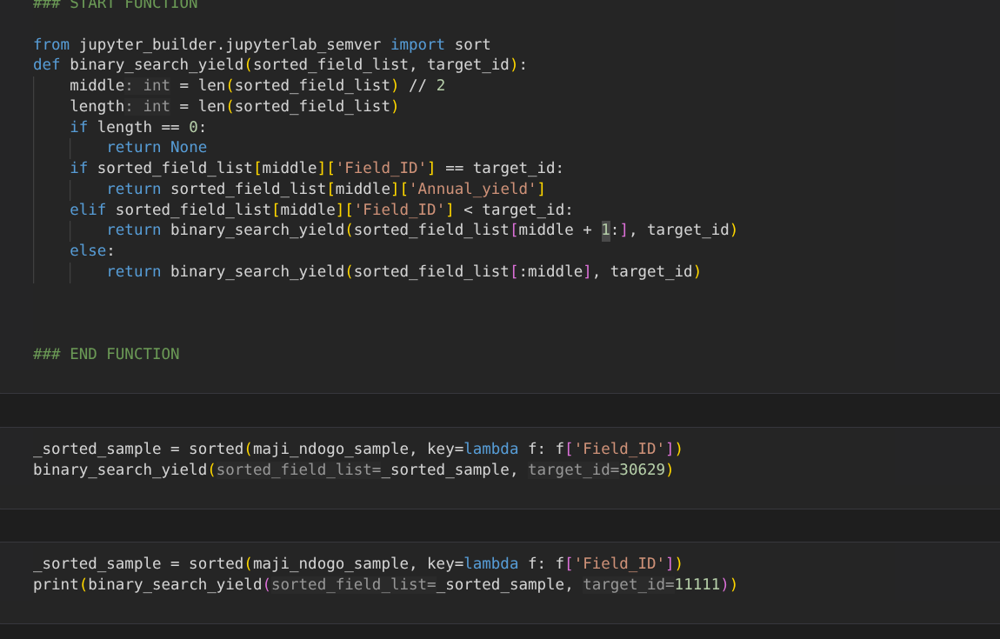
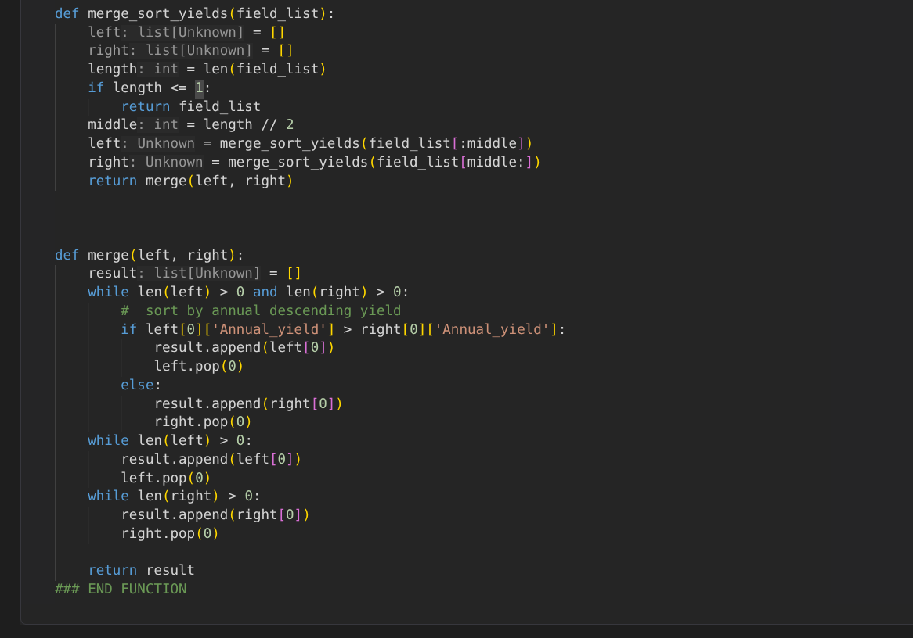
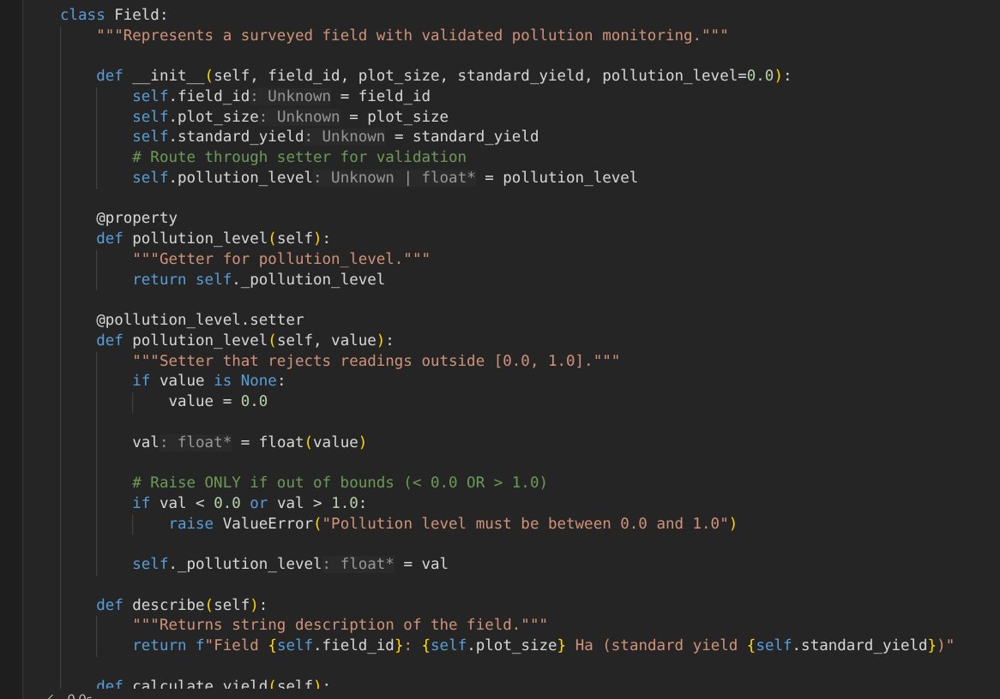
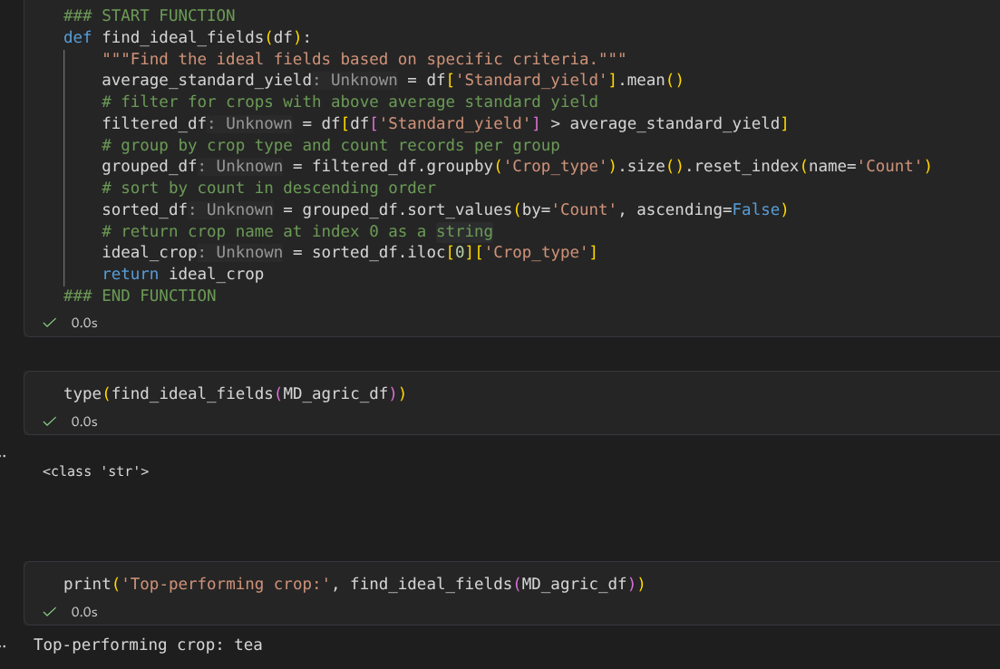

# Maji Ndogo: Enterprise-Grade Agricultural Analytics Engine

> **Headline:** Code Priced for a Million Records  
> **Core Pillars:** Algorithmic Scaling ($O(\log n)$ / $O(n \log n)$), Defensive Domain Modeling (OOP), Vectorized Pipelines (Pandas)

---

##  Architectural Problem Statement

* **The Problem:** Algorithmic latency under load—linear scans break down as data volume explodes, while unvalidated inputs produce skewed reports that lead to real-world resource misallocation.
* **The Solution:** A unified, defensive architecture built on $O(\log n)$ search efficiency, strict OOP encapsulation, and vectorized data pipelines—reducing execution latency and enabling seamless scaling across clean, well-architected codebases.

---

##  Technical Stack & Systems Architecture

* **Algorithmic Core (Performance & Scale):**
  *  `Python` — Custom $O(\log n)$ Binary Search & $O(n \log n)$ Merge Sort implementation for high-speed indexing without latency spikes under load.
* **Data Engineering & Analytics:**
  * `Pandas` & `NumPy` — Vectorized data transformations, multi-table joins, and aggregated grouping pipelines.
  * `SQL` — Schema normalization, relational joins, and database queries.
* **System Design & State Integrity:**
  * `Object-Oriented Python` — Encapsulated `Field` classes, abstract state contracts, and property getters/setters for point-of-entry data validation.
* **Environment & Tooling:**
  * `Linux (Kali/Ubuntu)` & `Git/GitHub` — Version control, modular repo structure, and terminal environment execution.

---

##  Key Technical Proofs

### 1. $O(\log n)$ Binary Search (`search_algorithms.py`)
>  By reducing lookup complexity from $O(n)$ to $O(\log n)$, a search across 5,654 survey records drops from up to 5,654 sequential checks to at most 13 comparisons.

### 2. Merge sort(`search_algorithms.py`)
It Guarantees $O(n \log n)$ worst-case time complexity prevents $O(n^2)$ latency spikes during bulk survey ingestions , maintaining predictable throughput as datasets increase in size

### Defensive Object-Oriented programming
Enforcing strict type boundaries and range validation at class instantiation/creation halts corrupted entries (e.g., negative yields or $7,000+$ outlier readings) before they pollute downstream statistical models.

### Pandas Vectorized Pipeline (`data-handling.py`)
Vectorized .groupby() and array aggregation bypass slow CPython loops, processing regional survey summaries in a single execution pass.

